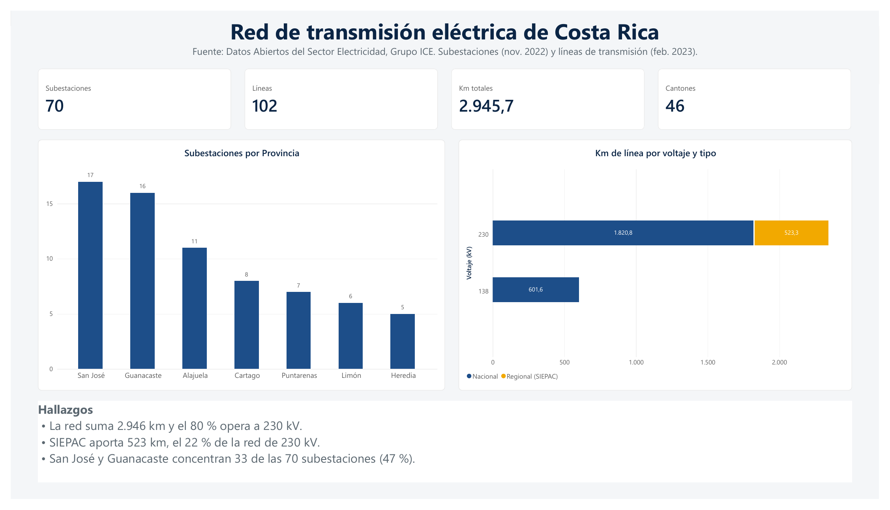
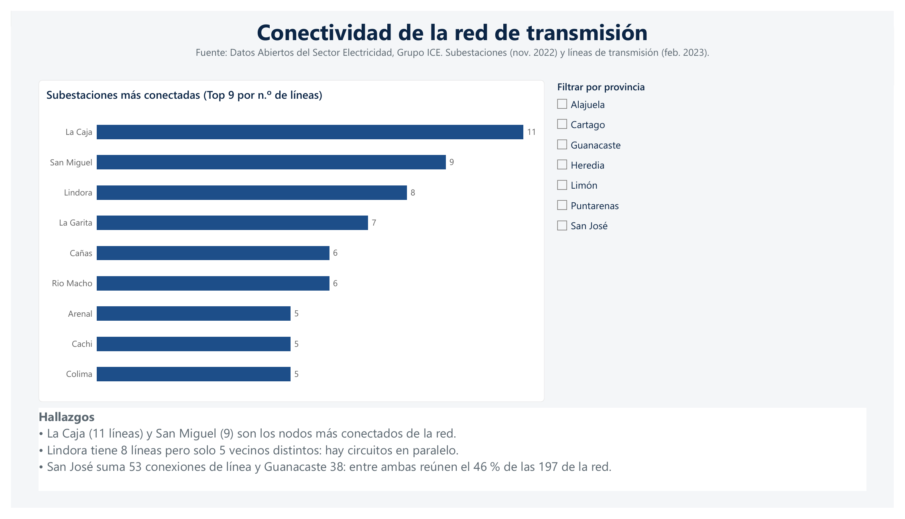
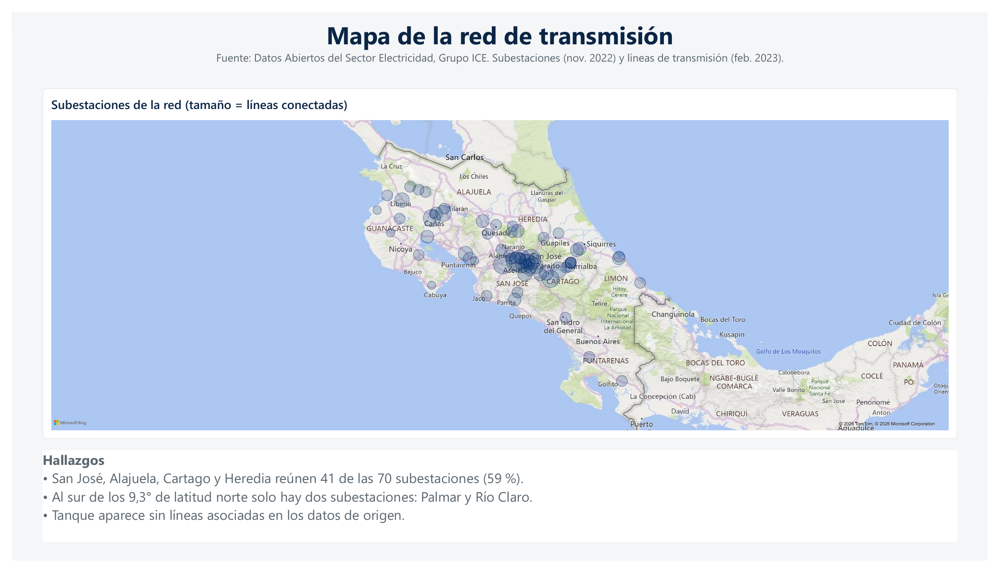
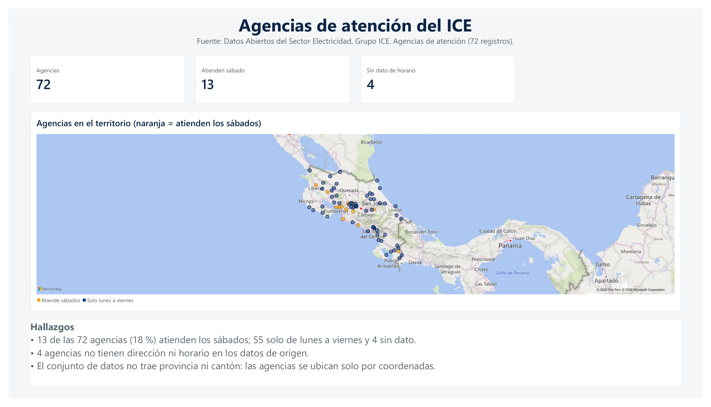

# Red de transmisión eléctrica de Costa Rica — Reporte en Power BI

Reporte de 4 páginas sobre la red de transmisión del ICE y sus agencias de atención, construido desde cero en Power BI Desktop a partir de datos abiertos: limpieza en Python, modelo en estrella, medidas DAX y diseño propio con un tema JSON.






## Fuente de los datos

Portal de Datos Abiertos del Sector Electricidad, Grupo ICE: <https://datos-ice-se.opendata.arcgis.com>

| Conjunto | Fecha de los datos | Registros |
|---|---|---|
| Subestaciones | noviembre 2022 | 70 |
| Líneas de transmisión | febrero 2023 | 102 |
| Agencias de atención | según el portal | 72 |

Las cifras reflejan esas fechas, no el estado actual de la red.

## Páginas del reporte

1. **Resumen.** 70 subestaciones, 102 líneas y 2.945,7 km de red. Subestaciones por provincia y kilómetros por voltaje y tipo.
2. **Conectividad.** Top 9 de subestaciones por líneas conectadas, con filtro por provincia.
3. **Mapa.** Las 70 subestaciones; el tamaño de la burbuja indica las líneas conectadas.
4. **Agencias.** 72 agencias; 13 atienden los sábados y 4 no tienen dato de horario.

## Hallazgos principales

- El 79,6 % de los kilómetros (2.344 km) es de 230 kV; los 602 km restantes son de 138 kV.
- El tramo SIEPAC suma 523 km, cerca del 22 % de la red de 230 kV.
- San José, Alajuela, Cartago y Heredia reúnen 41 de las 70 subestaciones (59 %).
- Las más conectadas son La Caja (11 líneas) y San Miguel (9). Lindora tiene 8 líneas pero solo 5 vecinos distintos, por circuitos paralelos.
- Al sur de los 9,3° N solo hay dos subestaciones: Palmar y Río Claro.
- 13 de las 72 agencias (18 %) atienden los sábados.

## Modelo de datos

- `fact_lineas` (102) y `dim_subestaciones` (70) con dos relaciones: `id_origen` (activa) e `id_destino` (inactiva, se usa con `USERELATIONSHIP`).
- `dim_agencias` (72) queda sin relación: no comparte llaves con la red.
- Medidas DAX en la tabla `_Medidas`: Subestaciones, Provincias, Cantones, Distritos, Líneas, Km totales, Km 230 kV, Km 138 kV, % Km 230 kV, Líneas como origen, Líneas como destino, Líneas conectadas, Agencias, Atienden sábado y Sin dato de horario.
- Columna calculada `dim_agencias[Horario sábado]` para la leyenda del mapa de agencias.

## Limpieza de datos (`limpieza_datos.py`)

- Provincias de 9 variantes a 7; cantones de 48 a 46; distritos identificados por código oficial (63; por nombre serían 59 porque se repiten entre cantones).
- Se verificó la coherencia entre provincia y código de distrito (0 filas incoherentes).
- Las coordenadas de Web Mercator y CRTM05 coinciden (diferencia máxima 0 m).
- **Longitud de las líneas.** El campo de longitud de la fuente está inflado por la proyección Web Mercator (~1,6 % sobre la longitud real) y `SHAPE_STLe` no coincide con la geometría. Los kilómetros se recalcularon sobre el GeoJSON con la fórmula de haversine.
- Se descartaron columnas vacías de agencias (`Nombre`, `Imagen`).

Para reproducir: `python limpieza_datos.py --raw data/raw --out data/clean` (requiere `pandas` y `pyproj`).

## Limitaciones

- **Extremos sin subestación.** 7 de los 204 extremos de línea (102 × 2) no corresponden a ninguna subestación del conjunto: 96 líneas enlazan sus dos extremos, 5 enlazan uno y la fila SIEPAC no trae ninguno. Por eso la suma de *Líneas conectadas* por subestación es 197 y no 204. Las líneas afectadas son Liberia–Frontera Nicaragua, Cahuita–Changuinola, Concavas–Aguas Calientes, Colorado–Cemex, Rio Claro–Progreso y SIEPAC. Los datos de origen no indican el motivo; por los nombres, parecen ser fronteras, clientes industriales u otras redes. *Líneas conectadas* se usa solo por subestación; para contar líneas se usa la medida *Líneas* (102).
- **Subestación sin líneas.** Tanque aparece sin líneas asociadas en los datos de origen.
- **Circuitos paralelos.** Se cuentan por separado, de modo que una subestación puede tener más líneas que vecinos.
- **Kilómetros de circuito.** Los km son kilómetros de circuito, no de corredor: dos circuitos paralelos suman dos veces.
- **Líneas fuera del mapa.** El mapa muestra solo subestaciones. El visual de mapa estándar no carga GeoJSON; ArcGIS for Power BI requiere compartir datos con Esri y Azure Maps requiere iniciar sesión en la tienda de visuales, por lo que no se usaron. El trazado está disponible en `data/clean/lineas_transmision.geojson`.
- **Agencias sin provincia.** Los datos no traen provincia ni cantón; se ubican solo por coordenadas. 4 agencias no tienen dirección ni horario (ids 48, 55, 58 y 59).

## Estructura del repositorio

```
data/raw/      datos originales descargados del portal
data/clean/    tablas limpias, GeoJSON y log de limpieza
limpieza_datos.py
tema_red_transmision_ice.json
Reporte_Red_Transmision_ICE.pbix
Reporte_Red_Transmision_ICE.pdf
docs/          capturas de las 4 páginas
```

## Créditos

Datos: Grupo ICE, Portal de Datos Abiertos del Sector Electricidad. Este proyecto es independiente y no está afiliado al ICE.
